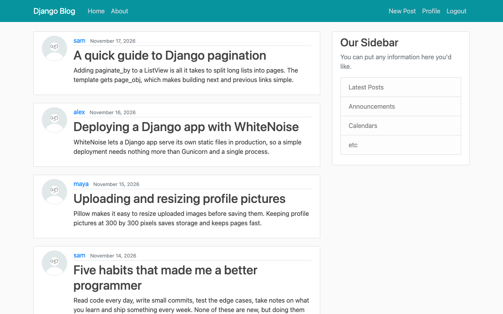
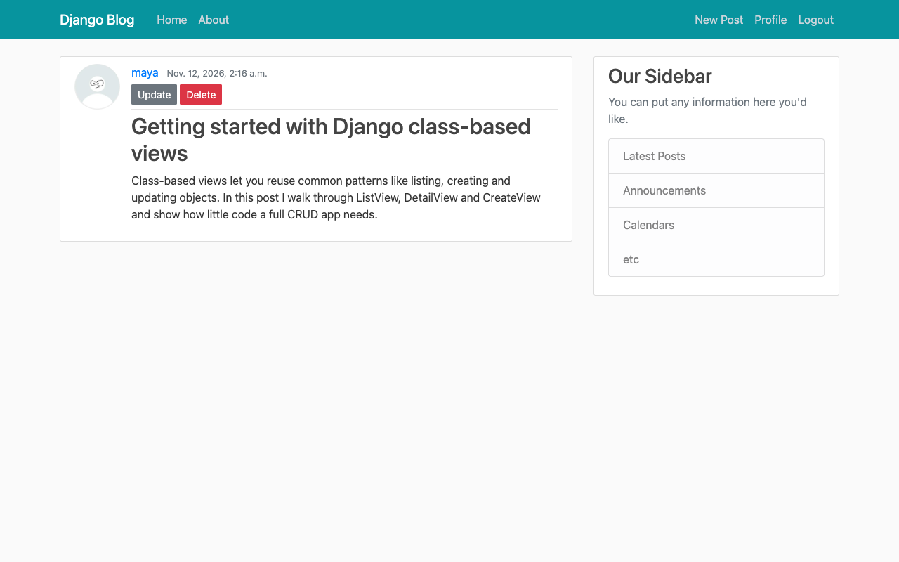
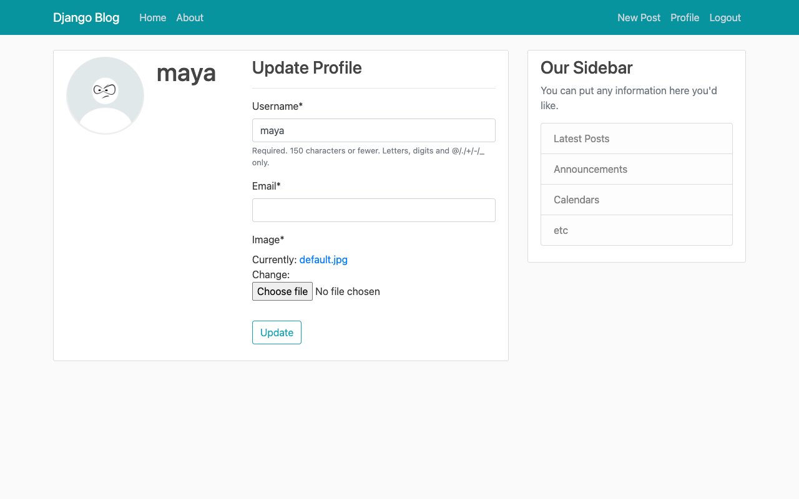
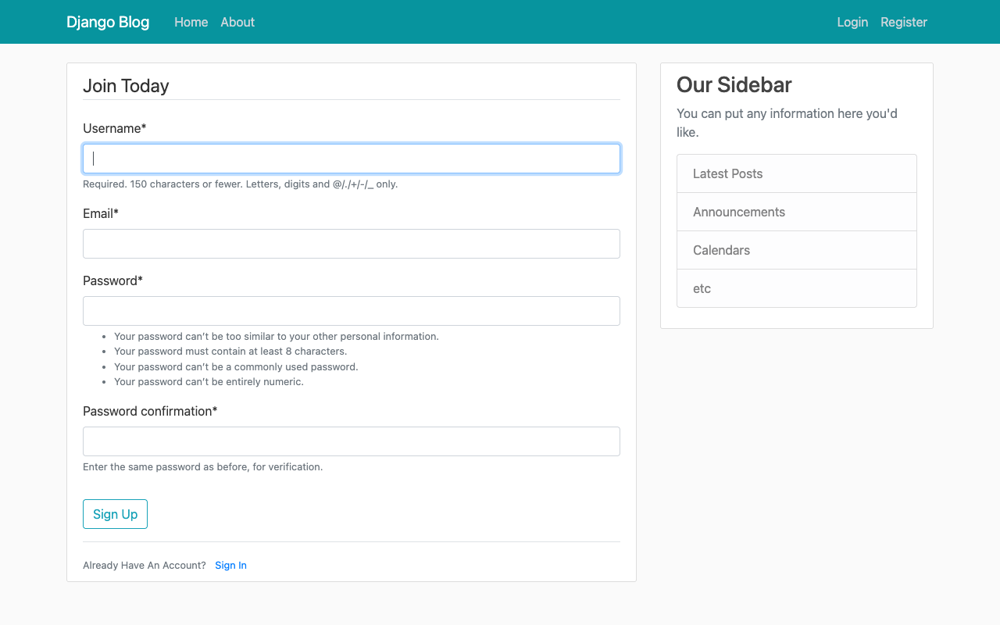

<div align="center">

# Blogost

A multi-user blogging website built with Django.

   

</div>

<table>
  <tr><th>Home</th></tr>
  <tr><td></td></tr>
</table>

## About

Blogost is a simple blogging platform where anyone can sign up, write posts and read what others have published. Each user gets a profile with an avatar, and authors can edit or delete only their own posts. It is built with Django's class-based views and authentication system, with Bootstrap 4 for the layout.

## Screenshots

| Post | Profile | Sign up |
| :---: | :---: | :---: |
|  |  |  |

<sub>Screenshots use demo users and posts.</sub>

## Features

- **Accounts**: sign up, log in and log out with Django authentication
- **Posts**: create, update and delete posts, with author-only permissions for editing
- **Feed**: a paginated list of the latest posts, plus a page for each author
- **Profiles**: update your username, email and profile picture; uploads are resized to 300 × 300 px with Pillow
- **Password reset** by email
- **Admin panel** for managing users and posts

## Tech Stack

| Area | Technology |
| --- | --- |
| Backend | Python, Django 3.1 (class-based views, auth, signals) |
| Frontend | Django templates, Bootstrap 4, django-crispy-forms |
| Database | SQLite |
| Images | Pillow |
| Deployment | Gunicorn, WhiteNoise |

## Getting Started

**Prerequisites:** Python 3.8

```bash
python -m venv venv
source venv/bin/activate
pip install -r requirements.txt

export DJANGO_SECRET_KEY="any-long-random-string"
python manage.py migrate
python manage.py createsuperuser
python manage.py runserver
```

Then open [http://127.0.0.1:8000](http://127.0.0.1:8000).

### Environment variables

| Variable | Required | Description |
| --- | --- | --- |
| `DJANGO_SECRET_KEY` | Outside local development | Django secret key |
| `EMAIL_USER` | For password reset | Gmail address used to send emails |
| `EMAIL_PASS` | For password reset | App password for that account |

## Project Structure

```
.
├── blog/          # posts: model, class-based views, templates, static files
├── users/         # registration, profiles and avatar resizing
├── project/       # settings and URL configuration
├── media/         # default profile picture (uploads are not committed)
├── screenshots/   # images used in this README
└── manage.py
```
